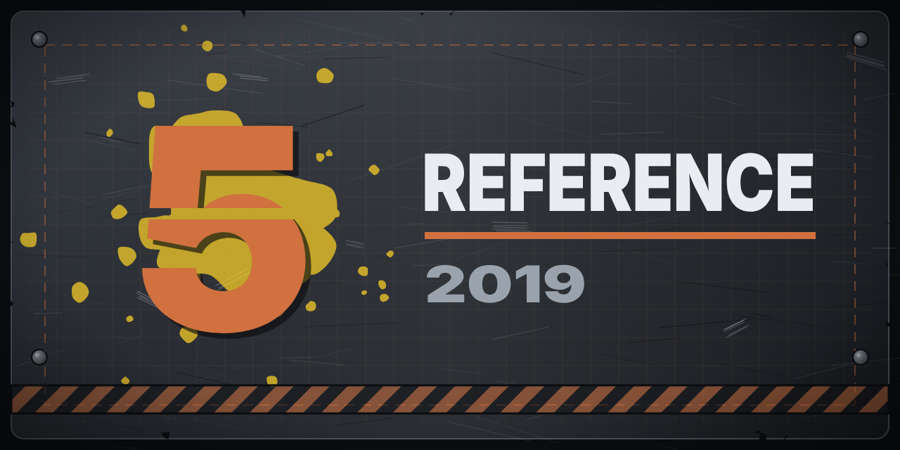

  

  

# GoW5DB-Reference

The reference screenshots behind [GoW5DB](https://github.com/GearsOfWarDatabases/GoW5DB) (the Gears 5 Database),
sorted by section, and the scripts that sort them (`sort-screenshots.py`, see `CLAUDE.md`). Included in GoW5DB as
its `ref/` submodule; the site doesn't need it to build.

Screenshot names carry no dates: Steam's `YYYYMMDDHHMMSS_N.jpg` names are renamed to `shot-NNNN.jpg`, and the
images have no metadata.

## License

The scripts and notes: Copyright (C) 2026 [Ryan Turner (TheSCREWEDSoftware)](https://github.com/TheSCREWEDSoftware)
and the GoW5DB contributors, under the GNU Affero General Public License, version 3 or (at your option) any later
version. See [LICENSE](LICENSE).

The screenshots show Gears 5, whose names, images and other game content belong to Microsoft and The Coalition.
They are kept here as reference for a non-commercial fan project and are not covered by this license.

## Made with

Made with the help of [Claude](https://claude.ai), Anthropic's AI assistant: written and reviewed together with it,
then tested and published by [Ryan Turner (TheSCREWEDSoftware)](https://github.com/TheSCREWEDSoftware).
